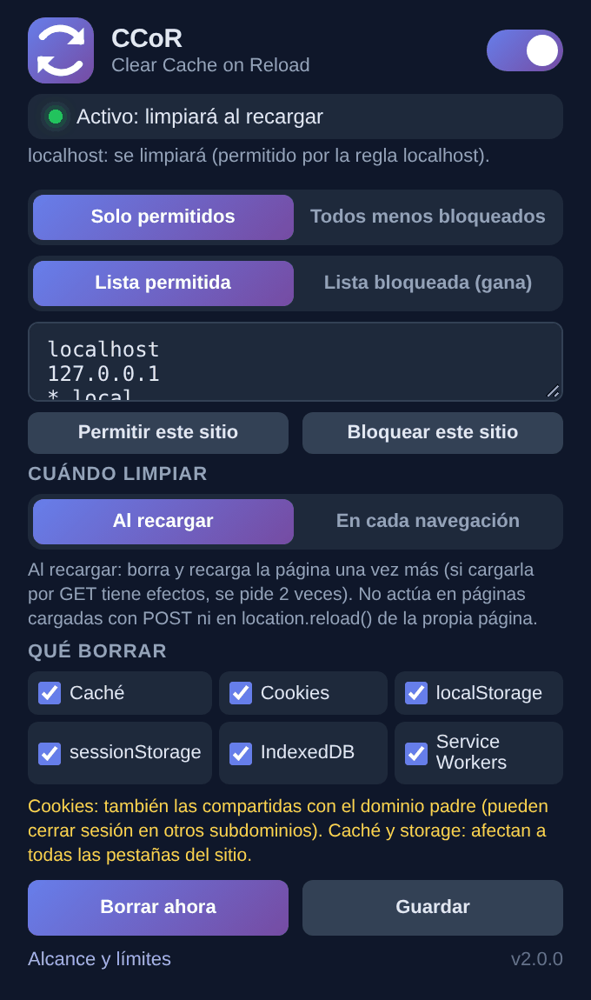
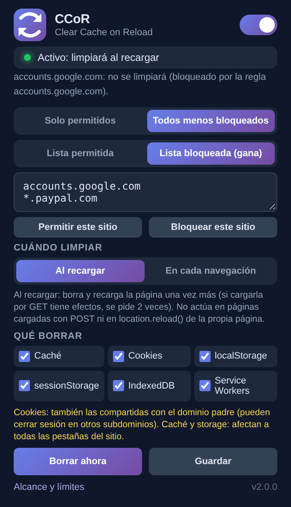
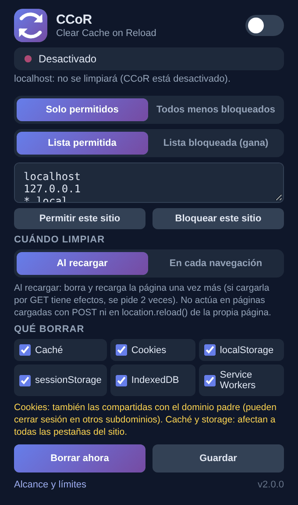

<p align="center">
  
</p>
<p align="center">
  
  
  
</p>

CCoR es una extensión para limpiar la caché y los datos de los sitios que elijas. Pensada para desarrollo web, comprobación de despliegues y depuración de recursos cacheados, con listas de dominios y controles desde el popup.

> [!WARNING]
> **Revisa "Qué borrar" antes de usarla.** En una instalación nueva, la configuración del código activa caché, cookies, localStorage, sessionStorage, IndexedDB y Service Workers. Las cookies compartidas con el dominio padre pueden cerrar sesiones en otros subdominios. Desmarca los tipos de datos que quieras conservar.

<!-- -->

> [!NOTE]
> Hay pruebas automáticas en Chrome 156 sin interfaz. La comprobación manual del popup en Chrome, el atajo y la insignia ON siguen pendientes. No se afirma compatibilidad verificada con otros navegadores.

**Contenido:** [Vista del popup](#vista-del-popup) · [Funciones](#funciones) · [Instalación](#instalación) · [Uso](#uso) · [Alcance y límites](#alcance-y-límites) · [Pruebas](#pruebas) · [Permisos y privacidad](#permisos-y-privacidad) · [Desarrollo](#desarrollo) · [Preguntas frecuentes](#preguntas-frecuentes)

## Vista del popup

Capturas del HTML y CSS actuales, renderizados con datos de ejemplo. Muestran la interfaz del proyecto, no una prueba manual de la extensión instalada en Chrome.

<table>
  <tr>
    <th>Solo permitidos</th>
    <th>Sitio bloqueado</th>
    <th>Desactivado</th>
  </tr>
  <tr>
    <td></td>
    <td></td>
    <td></td>
  </tr>
</table>

La lista bloqueada tiene prioridad. El texto bajo el estado indica qué ocurrirá en la pestaña actual; el interruptor permite desactivar la limpieza automática.

## Funciones

| Control | Qué permite |
|---|---|
| Dónde limpiar | Solo sitios permitidos, o todos excepto los bloqueados. |
| Cuándo limpiar | Al recargar, o en cada navegación. |
| Qué borrar | Caché, cookies, localStorage, sessionStorage, IndexedDB y Service Workers. |
| Acciones del popup | Permitir o bloquear el sitio actual, borrar ahora y guardar ajustes. |
| Patrones | Dominios, `*.web.com`, URLs completas y comentarios con `#`. |
| Controles adicionales | Atajo `Alt+Shift+C`, insignia ON y contador local de limpiezas. Implementados; atajo e insignia pendientes de verificación manual. |

El botón de sitios sensibles añade sugerencias a la lista bloqueada solo si lo pulsas. No hay una lista sensible aplicada automáticamente.

## Instalación

La distribución actual es el código fuente. **No está publicada en Chrome Web Store.**

1. Descarga el código desde **Code → Download ZIP** y descomprímelo, o clona el repositorio:
   ```bash
   git clone https://github.com/EsdrasMujica/clear-cache-on-reload.git
   ```
2. Abre `chrome://extensions/`.
3. Activa el **Modo de desarrollador**.
4. Pulsa **Cargar extensión sin empaquetar** y selecciona la carpeta que contiene `manifest.json`.
5. Abre el popup desde el menú de extensiones. Puedes fijar su icono a la barra de Chrome.

## Uso

1. Revisa los tipos de datos marcados en **Qué borrar**. Para limpiar solo recursos cacheados, deja marcada únicamente **Caché**.
2. Elige **Solo permitidos** para limitar la limpieza a tu lista, o **Todos menos bloqueados** para actuar en el resto de sitios.
3. Añade dominios a las listas o usa **Permitir este sitio** / **Bloquear este sitio**.
4. Elige **Al recargar** o **En cada navegación** y comprueba el aviso de la pestaña actual.
5. Guarda los ajustes y recarga la página para usar la limpieza automática.

Ejemplo de lista permitida:

```text
localhost
127.0.0.1
*.miweb.dev
# Una regla por línea
```

`miweb.dev` cubre solo ese host. `*.miweb.dev` cubre el dominio base y sus subdominios. Una coincidencia en la lista bloqueada siempre gana.

> [!IMPORTANT]
> El interruptor y las listas controlan la **limpieza automática**. **Borrar ahora** es una acción manual sobre la pestaña actual y usa los tipos de datos seleccionados, incluso si CCoR está desactivado o el sitio está bloqueado.

## Alcance y límites

> **Alcance.** Según la documentación de `chrome.browsingData`, `origins` aplica a caché, storage y cookies, pero las cookies se borran de todo el dominio registrable. Por eso CCoR borra las cookies aparte: solo las que el navegador enviaría a esa URL, incluidas las compartidas con el dominio padre (`Domain=...`), que pueden cerrar sesión en otros subdominios. Las cookies host-only de subdominios hermanos no se tocan. Caché, localStorage, IndexedDB, CacheStorage y Service Workers se borran por origen y afectan a todas las pestañas de ese origen.
>
> **Modo "al recargar".** Chrome solo informa del tipo de navegación (`transitionType: "reload"`) en `webNavigation.onCommitted`, cuando la página ya empezó a cargar. CCoR borra entonces y recarga la pestaña una vez más (sin caché). No detecta `location.reload()` hecho por la página (Chrome lo marca como `link`) y no actúa si la página se cargó con POST (para no repetir el envío del formulario). Para no confundir la recarga propia con un F5 real, CCoR deja una marca de 5 s por pestaña; se retira al confirmarse la recarga, si la carga falla (`onErrorOccurred`) o si se cierra la pestaña. Límite residual: un F5 en esos 5 s inmediatos tras una recarga propia que aún no se haya confirmado no se limpia. Si cargar la URL por GET tiene efectos, se pedirá dos veces. Navegar a otra URL, enlaces o formularios a la misma URL, escribir la URL y Atrás/Adelante no cuentan como recarga.
>

## Pruebas

| Comprobación | Estado |
|---|---|
| Lógica de listas y patrones | `node test.js`. |
| Borrado y aislamiento entre orígenes | Batería automática en Chrome 156 sin interfaz, con datos reales de caché, cookies, localStorage, IndexedDB, CacheStorage y Service Workers. Incluyó 40 repeticiones del aislamiento entre orígenes. |
| Casos de navegación | Pruebas automáticas de POST, redirecciones, meta refresh y doble F5. |
| Popup dentro de Chrome, atajo e insignia ON | Pendiente de verificación manual. Las capturas de este README no sustituyen esa prueba. |
| Edge, Brave, Firefox y otras versiones de Chrome | Sin verificar. |

Los resultados de la batería de navegador corresponden a la revisión del proyecto del 14 de noviembre de 2026. El test de listas está incluido en este repositorio; la batería de navegador no está incluida aquí como suite reproducible.

## Permisos y privacidad

| Permiso | Uso |
|---|---|
| `browsingData` | Borrar caché y almacenamiento del origen elegido. |
| `cookies` | Borrar las cookies que el navegador enviaría al sitio. |
| `webNavigation` | Detectar la navegación y el tipo de recarga. |
| `webRequest` | Observar GET/POST de la petición principal para evitar repetir POST. No bloquea ni modifica peticiones. |
| `scripting` | Vaciar localStorage y sessionStorage en la pestaña, comprobando el origen. |
| `storage` | Guardar ajustes, listas y estadísticas de uso. |
| `host_permissions: <all_urls>` | Poder actuar en los sitios que incluyas en tu configuración. |

No hay servidor propio, analítica ni código remoto en la extensión. Los ajustes y las listas se guardan en `chrome.storage.sync`, que Chrome puede sincronizar con tu cuenta; el contador, el último host y los mensajes de estado se guardan en `chrome.storage.local`. No se borra el historial ni las contraseñas guardadas.

## Desarrollo

### Estructura

```text
clear-cache-on-reload/
├── manifest.json       # Configuración Manifest V3
├── background.js       # Service worker y limpieza
├── ccor-core.js        # Listas, patrones y decisiones compartidas
├── test.js             # Pruebas de listas
├── popup.html          # Interfaz
├── popup.css           # Estilos
├── popup.js            # Controles del popup
├── icons/              # Iconos SVG y PNG
├── docs/               # Capturas de interfaz
├── LICENSE
└── README.md
```

### Trabajar en local

Necesitas Chrome para cargar la extensión y Node.js para ejecutar los tests de listas.

```bash
node test.js
```

Después de editar, pulsa **Recargar** en la tarjeta de `chrome://extensions/`. Si cambiaste `popup.*`, cierra y abre el popup. Para revisar `background.js`, abre el enlace de **service worker** de esa tarjeta.

### Empaquetar la extensión

Desde la raíz del proyecto:

```bash
zip -r clear-cache-on-reload-v2.0.0.zip manifest.json background.js ccor-core.js popup.html popup.css popup.js icons
```

Este paquete contiene la extensión para cargarla sin empaquetar; no es una publicación en la tienda.

## Preguntas frecuentes

**¿Qué se borra por defecto?**  
En una instalación nueva se activan todos los tipos de datos de **Qué borrar**, no solo caché. Si ya usabas la extensión, tus ajustes guardados pueden ser distintos. Desmarca lo que quieras conservar antes de limpiar.

**¿Puede cerrar mis sesiones?**  
Sí, al borrar cookies. Las cookies compartidas con el dominio padre pueden afectar a otros subdominios. El historial y las contraseñas guardadas no se borran.

**¿Por qué se recarga dos veces?**  
Chrome informa de la recarga cuando la página ya empezó a cargar. CCoR limpia entonces y hace una recarga extra sin caché. Consulta los límites de GET, POST y la marca de 5 segundos arriba.

**¿Funciona en Firefox, Edge o Brave?**  
No se ha verificado. Las pruebas automáticas descritas se hicieron en Chrome 156 sin interfaz.

**¿Cómo excluyo un sitio?**  
Añádelo a la lista bloqueada. Esa lista gana en ambos modos automáticos. No limita el botón manual **Borrar ahora**.

## Próximos pasos

- Verificar manualmente el popup de Chrome, el atajo y la insignia.
- Evaluar compatibilidad con otros navegadores, incluido Firefox.
- Añadir traducciones.

## Contribuir

1. Haz un fork y crea una rama: `git checkout -b feature/mi-mejora`.
2. Aplica los cambios y ejecuta `node test.js`.
3. Haz commit, sube la rama y abre un Pull Request describiendo qué cambió y cómo lo probaste.

## Licencia

[MIT](LICENSE) · © 2026 Esdras Mujica.
