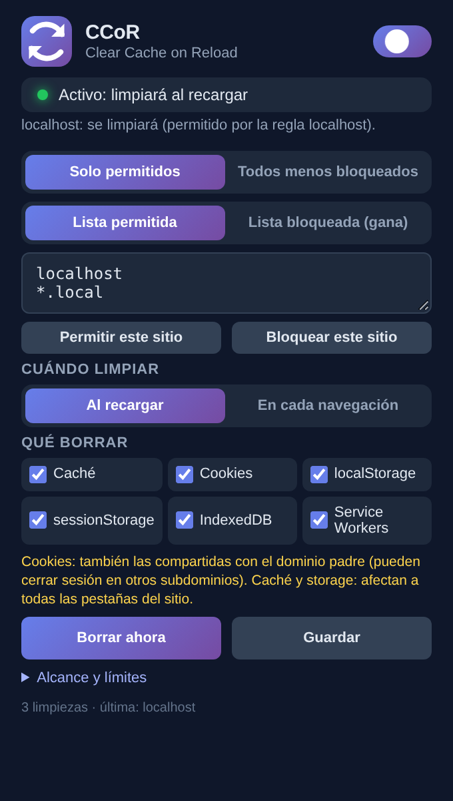

# 🧹 CCoR - Clear Cache on Reload

> Extensión de Chrome (Manifest V3) que **borra la caché y, si lo eliges, los datos del sitio actual** cuando recargas la página, solo en los sitios que tú decidas. Ideal para desarrollo web, pruebas de despliegues y depuración de assets cacheados.


---

## ✨ Características

- 🔄 **Al recargar** (detecta recargas reales: F5, Ctrl+R, Ctrl+Shift+R) o **en cada navegación**, a elegir.
- ✅ **Lista permitida** y ⛔ **lista bloqueada**: modo "solo permitidos" o "todos menos bloqueados". La lista bloqueada siempre gana.
- 🛡️ Botón opcional que añade sitios sensibles sugeridos (accounts.google.com, *.paypal.com) a tu lista bloqueada. Nada va bloqueado por defecto.
- 🧩 Patrones `*.web.com` (subdominios y dominio base), URLs completas y comentarios con `#`.
- 🎛️ **Qué borrar**: caché, cookies, localStorage, sessionStorage, IndexedDB y Service Workers.
- ⚡ Botones "Permitir / Bloquear este sitio", "Borrar ahora", insignia ON y atajo **Alt+Shift+C**.
- 🔒 **Privacidad total**: sin servidores, sin analítica, sin código remoto. Ajustes en `chrome.storage.sync`, contador en `chrome.storage.local`.

---

## 📸 Captura

<p align="center">
  
</p>

---

## 🚀 Instalación

### Opción 1 — Desde el código fuente (modo desarrollador)

1. Clona el repositorio:
   ```bash
   git clone https://github.com/EsdrasMujica/clear-cache-on-reload.git
   ```
2. Abre `chrome://extensions/` en tu navegador.
3. Activa el **Modo de desarrollador** (esquina superior derecha).
4. Pulsa **Cargar extensión sin empaquetar** y selecciona la carpeta del repo.
5. ¡Listo! El icono aparecerá en la barra de extensiones.

### Opción 2 — Chrome Web Store

_Próximamente._

---

## 🖱️ Uso

1. Haz clic en el icono de la extensión.
2. Activa el interruptor de arriba y elige el modo: **Solo permitidos** o **Todos menos bloqueados**.
3. Añade sitios con los botones del popup o escribiéndolos en las listas.
4. Elige **Cuándo limpiar**: *Al recargar* (F5, Ctrl+R, Ctrl+Shift+R) o *En cada navegación*.
5. Recarga la página: se borran los datos elegidos de ese sitio.

Si está desactivada o el sitio no entra en las listas, la extensión no toca nada. El popup te dice qué pasará con la pestaña actual.

> **Alcance.** Según la documentación de `chrome.browsingData`, `origins` aplica a caché, storage y cookies, pero las cookies se borran de todo el dominio registrable. Por eso CCoR borra las cookies aparte: solo las que el navegador enviaría a esa URL, incluidas las compartidas con el dominio padre (`Domain=...`), que pueden cerrar sesión en otros subdominios. Las cookies host-only de subdominios hermanos no se tocan. Caché, localStorage, IndexedDB, CacheStorage y Service Workers se borran por origen y afectan a todas las pestañas de ese origen.
>
> **Modo "al recargar".** Chrome solo informa del tipo de navegación (`transitionType: "reload"`) en `webNavigation.onCommitted`, cuando la página ya empezó a cargar. CCoR borra entonces y recarga la pestaña una vez más (sin caché). No detecta `location.reload()` hecho por la página (Chrome lo marca como `link`) y no actúa si la página se cargó con POST (para no repetir el envío del formulario). Para no confundir la recarga propia con un F5 real, CCoR deja una marca de 5 s por pestaña; se retira al confirmarse la recarga, si la carga falla (`onErrorOccurred`) o si se cierra la pestaña. Límite residual: un F5 en esos 5 s inmediatos tras una recarga propia que aún no se haya confirmado no se limpia. Si cargar la URL por GET tiene efectos, se pedirá dos veces. Navegar a otra URL, enlaces o formularios a la misma URL, escribir la URL y Atrás/Adelante no cuentan como recarga.
>
> **Pruebas realizadas:** `node test.js` (lógica de listas) y una batería automática en Chrome 156 sin interfaz (datos reales de caché, cookies, localStorage, IndexedDB, CacheStorage y Service Workers; POST, redirecciones, meta refresh, doble F5 y 40 repeticiones del aislamiento entre orígenes). **Sin verificar:** prueba manual con la interfaz real de Chrome, el atajo Alt+Shift+C y la insignia ON, Edge, Brave, Firefox y otras versiones de Chrome.

---

## 🔐 Permisos solicitados

| Permiso | Por qué se usa |
|---|---|
| `browsingData` | Para borrar caché, localStorage, IndexedDB y Service Workers del sitio. |
| `cookies` | Para borrar las cookies que se envían al sitio. |
| `webNavigation` | Para detectar la navegación o la recarga (`transitionType`). |
| `webRequest` | Solo observa el método (GET/POST) de la petición principal, para no repetir un POST. No bloquea ni modifica nada. |
| `scripting` | Para vaciar localStorage y sessionStorage de la pestaña. |
| `storage` | Para guardar tus ajustes y listas. |
| `host_permissions: <all_urls>` | Para poder actuar en cualquier sitio que añadas a tus listas. |

> No se recopila, almacena ni envía ningún dato fuera de tu navegador.

---

## 🛠️ Estructura del proyecto

```
clear-cache-on-reload/
├── manifest.json          # Configuración MV3
├── background.js          # Service worker (escucha recargas y borra datos)
├── ccor-core.js           # Listas, patrones y decisión (compartido y testeado)
├── test.js                # Tests de la lógica: node test.js
├── popup.html             # UI del popup
├── popup.css              # Estilos del popup
├── popup.js               # Lógica del popup
├── icons/                 # ccor.svg + icon16/48/128.png
├── docs/screenshot.png
└── README.md
```

---

## 🧑‍💻 Desarrollo

### Requisitos
- Chrome / Edge / Brave actualizado.
- Editor de texto (VS Code recomendado).

### Flujo de trabajo
1. Edita los archivos.
2. Ve a `chrome://extensions/` y pulsa el icono de **recargar** en la tarjeta de la extensión.
3. Si tocaste el `popup.*`, cierra y vuelve a abrir el popup.
4. Si tocaste `background.js`, mira los logs en **"service worker"** dentro de la tarjeta de la extensión.

### Empaquetar para distribución

```bash
zip -r clear-cache-on-reload-v2.0.0.zip manifest.json background.js ccor-core.js popup.html popup.css popup.js icons
```

---

## ❓ FAQ

**¿Borra mis cookies o mi historial?**
Por defecto solo borra la **caché** del sitio. Cookies, localStorage, sessionStorage, IndexedDB y Service Workers solo se borran si los marcas en "Qué borrar"; activar Cookies pide confirmación. El historial y las contraseñas guardadas no se tocan. Las cookies compartidas con el dominio padre pueden cerrar sesión en otros subdominios.

**¿Funciona en Firefox?**
No verificado. Solo se ha probado en Chrome 156.

**¿Ralentiza la navegación?**
La limpieza solo se ejecuta en los sitios elegidos. En modo "Al recargar" hay una recarga extra de la página.

**¿Puedo excluir ciertos sitios?**
Sí: usa la lista bloqueada o el modo "todos menos bloqueados".

---

## 🗺️ Roadmap

- [x] Lista permitida / lista bloqueada de dominios.
- [x] Borrar también cookies y storage (opcional).
- [x] Atajo de teclado (Alt+Shift+C, cambiable en chrome://extensions/shortcuts).
- [ ] Soporte para Firefox.
- [ ] Traducción a inglés y otros idiomas.

---

## 🤝 Contribuir

1. Haz un fork.
2. Crea una rama: `git checkout -b feature/mi-mejora`.
3. Commit: `git commit -m "feat: añade X"`.
4. Push: `git push origin feature/mi-mejora`.
5. Abre un Pull Request.

---

## 📄 Licencia

MIT © 2026 — Esdras Mujica

Consulta el archivo [LICENSE](LICENSE) para más detalles.

---

<p align="center">
  Hecho con ☕ y mucha caché borrada.
</p>
